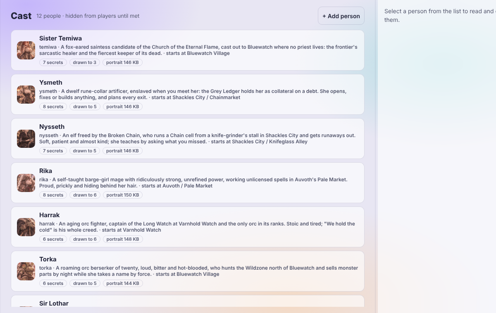
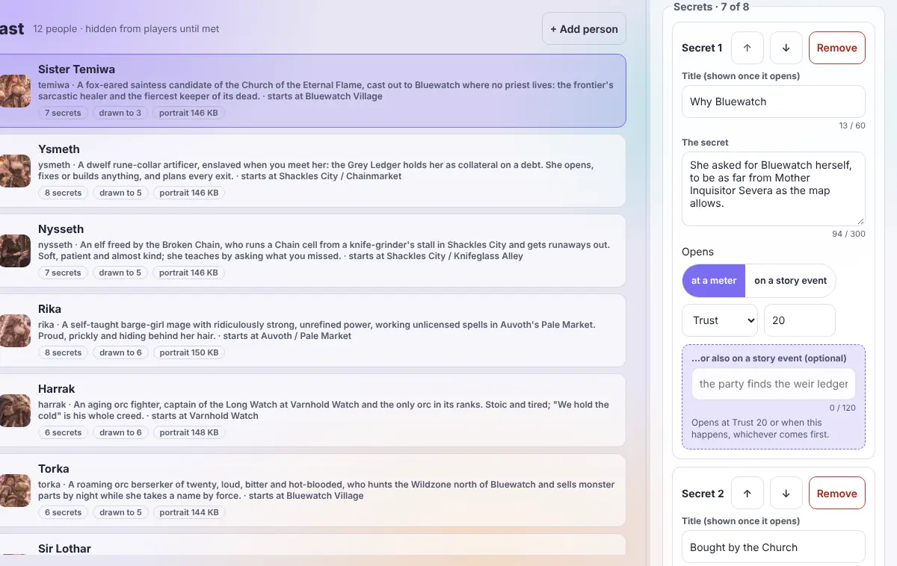
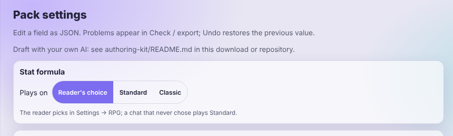
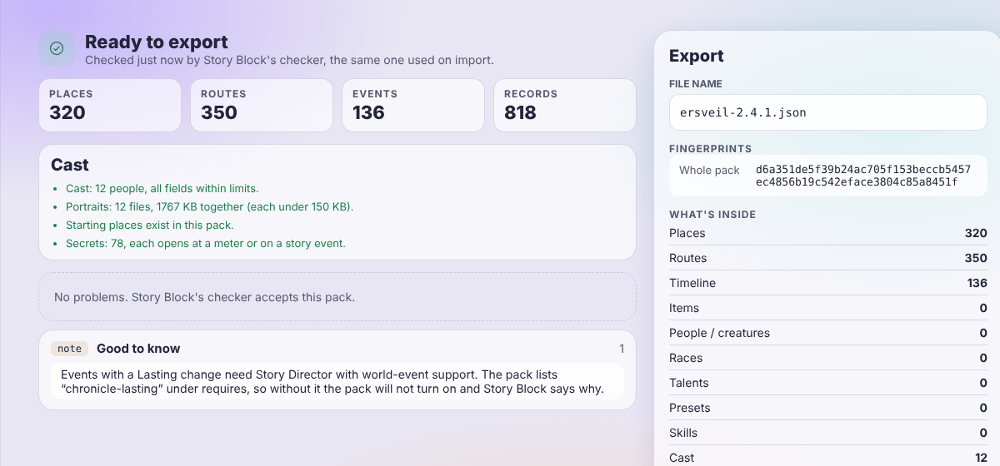

# Story Studio 0.6.0

Story Studio is a pack editor for the Story Suite. You write a world, its people and its events here, check it, and export a pack file. Story Block imports that file.

It is one HTML page. It runs in your browser, offline, with no server and no account. It never calls an AI or the network.

For AI assistants that read this repository, see [AI-README.md](AI-README.md).

## Install

Studio is not a SillyTavern extension. There is nothing to install.

1. Download [dist/story-studio.html](dist/story-studio.html).
2. Open it in a browser. A file on disk is fine.
3. Choose **Open pack...** and pick a `pack.json` or a pack `.zip`. You can also drop the file on the page.

To play a pack you need the suite. Install **Story Block** first. Add **Story Director** and **NPC State Delta** if you want them; both are optional and both need Story Block. Then import the file you exported in Story Block, under Settings, Tabs & Packs.

## What you see and do

The page has a header (pack name, Undo, Redo, Open pack, Problems, Export, theme) and a list of pack parts on the left. On a phone, the list folds into one bar.

- **Places, Routes, Items, People / creatures.** Add, edit, rename and remove records. A rename updates everything that points at the record. Removing a record that others use asks first.
- **Timeline.** Your events, grouped by story year. Each event has a date or an "after another event", the places it needs, the news the narrator is told once, and an optional lasting change in Story Director's chronicle. **Write with an AI** builds a prompt from your pack. You paste it into any AI chat, paste the answer back, and Studio adds the events as drafts for you to keep or discard.
- **Cast.** The people your story meets, each with a portrait, a starting place, what draws them to the party, relationship meters, stages and up to eight secrets. A secret opens at a meter value, on a story event, or whichever comes first.
- **Pack settings.** The **Stat formula** a story plays on (Reader's choice, Standard or Classic), then every other pack field (calendar, weather, money, start state and more) as JSON.
- **Settings defaults.** Shows what a pack can and cannot set. A pack cannot ship reader settings.
- **Screen builder.** Build screens and layouts with a live preview.
- **Data modules.** Forms, a grammar preview and a simulator for small rule modules. Story Block checks and runs them.
- **Code module.** Fill one form, download a zip that holds a starter SillyTavern module with its own tests.
- **Narrator card, Lorebook, Import lorebook.** Make a character card (JSON or PNG) and a World Info file from your pack, or bring World Info entries in as drafts.
- **Problems** and **Check / export.** The check is Story Block's own, so Studio and the game agree. Each problem has a Go to button. Export opens when the pack passes.

*The cast list, with portraits and what each person carries.*

*Write a person's hidden notes. Each opens at a meter, on a story event, or whichever comes first.*

*Choose which stat formula a pack plays on.*

*Check shows what Story Block's own checker says before you export.*

## Packs and portraits

- A pack with no cast exports as one `pack.json`.
- A pack with a cast exports as one `.zip` (`pack.json` and a `portraits` folder), or as `pack.json` alone.
- Pick any JPEG, PNG or WebP as a portrait. Studio shrinks it in the browser to a WebP of at most 150 KB and 1200 px on the long side.
- A pack names up to 32 portrait files.
- **Open pack** takes the `.zip` back. It uses Story Block's own zip reader, so both refuse the same files.
- A pack file you opened and did not change exports byte for byte.

## Settings worth knowing

- **Dark theme / Light theme** in the header. Your choice is remembered in this browser.
- On a wide screen you can drag the dividers to resize the parts list and the inspector. The widths are remembered on this device.
- **Undo** and **Redo** keep every edit, drafts and portraits included.
- Your work is kept in this browser as you go (see Troubleshooting). Export to keep a real copy.

## How the four fit together

The Story Suite has four parts.

- **Story Block** (2.16.1) is the hub. It keeps the story's state, runs the packs and draws the reader's screens.
- **Story Director** (2.9.1) adds the story clock, the map, quests, the world's events and the pack's living cast. It needs Story Block.
- **NPC State Delta** (1.7.1) adds a dossier for each person you meet, with meters, stages and secrets. It needs Story Block; with Story Director it also follows the cast and Key people.
- **Story Studio** (0.6.0) is a separate page where you write packs. It is not an extension.

Install Story Block first, then Story Director, then NPC State Delta if you want it. Data flows one way: you write a pack in Studio and import it in Story Block; Story Director reads what Story Block holds, and NPC State Delta reads both. Nothing flows back to Studio.

Studio carries its own copy of Story Block's pack checker, so its verdict matches the game's.

## Limits

- One `pack.json` is at most 512 KB. A cast holds at most 64 people and eight secrets per person.
- A portrait is at most 150 KB and 1200 px after Studio shrinks it. A pack names at most 32.
- A zip holds `pack.json` and the portraits, at most 40 entries.
- RPG Battle is no longer supported. Its rules packs cannot be imported, and its chats should stay on the previous versions.
- Narrator card, Code module and lorebook-review drafts last only for the session. Download them before you reload.
- Studio never calls an AI. **Write with an AI** only makes text for you to paste somewhere else.
- A lasting change needs Story Director with world-event support. Without it the pack stays off and Story Block says why.

## Troubleshooting

- **Export is greyed out.** The pack has problems. Open **Problems** and use Go to on each line.
- **Changes are missing from the end of replies.** The reply was probably cut short, and a cut line is not read. Raise SillyTavern's reply length setting.
- **A chat was stuck on "A native change is finishing...".** Update to Story Block 2.16.1 and NPC State Delta 1.7.1. A stuck chat heals when it opens.
- **A pack will not turn on.** Read the line Story Block shows. A lasting change needs Story Director with world-event support.
- **A portrait is refused or left out.** It is not a JPEG, PNG or WebP, or it could not be made small enough. Choose another picture.
- **My work is gone after a reload.** Studio keeps the pack, its drafts and its portraits in this browser's storage. A private window, cleared site data or blocked storage loses them. Export often.
- **A pack file will not open.** It is over 512 KB, or the check refused it. The message names the field.

## Development

Use Node 24. `npm run sync-sb -- --from <Story Block checkout>` updates the copy of Story Block's runtime and the authoring kit. `npm run build` rebuilds the standalone page. `npm run check` checks syntax. `npm test` runs the full suite; its browser tests need Chromium, and `STUDIO_CHROMIUM_PATH` can point at one.

## More

- [The authoring kit](authoring-kit/README.md): prompts, references and a checker for drafting a pack from your own notes with your own AI.
- [The AI prompt for events, with blanks](docs/AI_PROMPT.md)
- [Application guide](docs/STUDIO_PART2.md) and [engine and tool reference](docs/STUDIO.md)
- [Assets and credits](docs/ASSETS.md)
- [Changelog](CHANGELOG.md)

Licensed under [AGPL-3.0](LICENSE).
